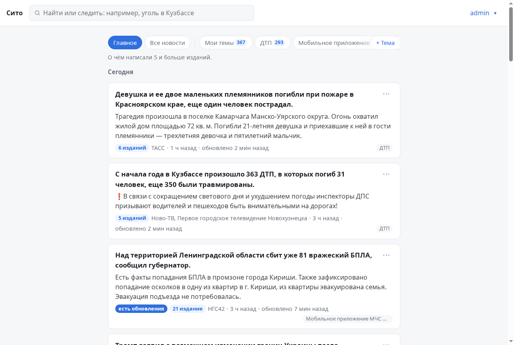
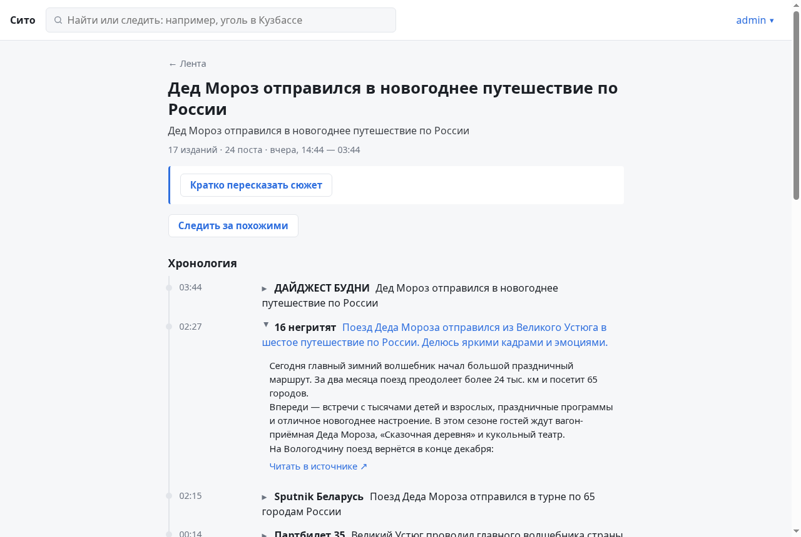
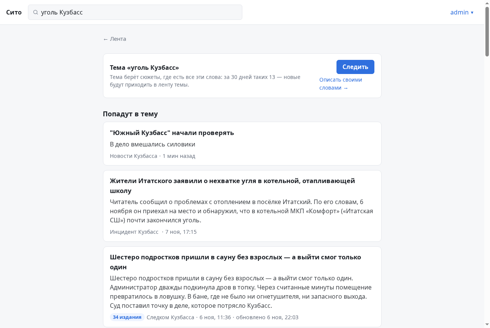
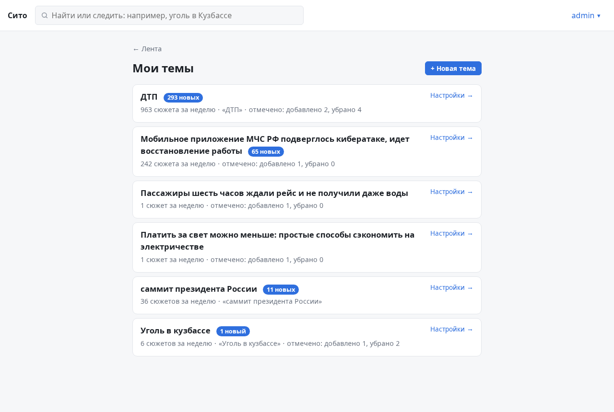
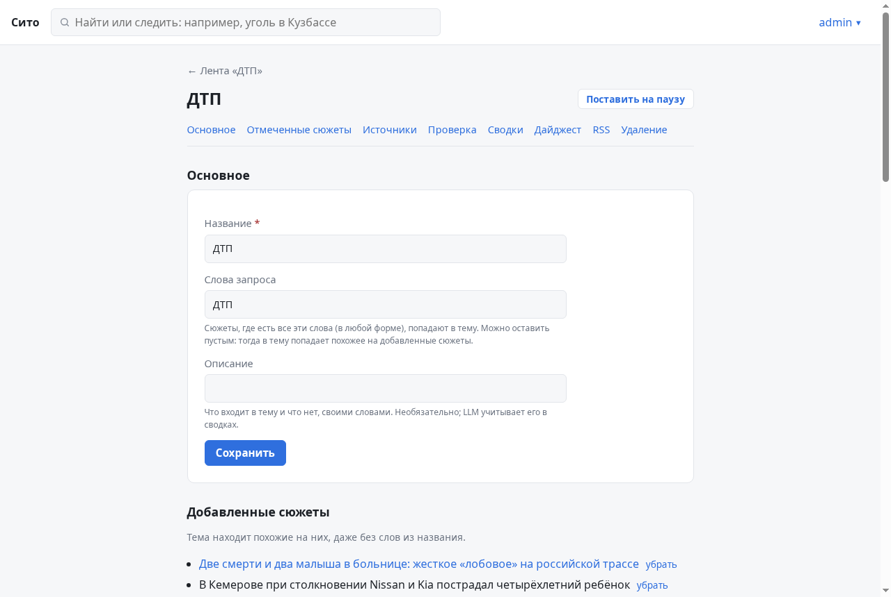
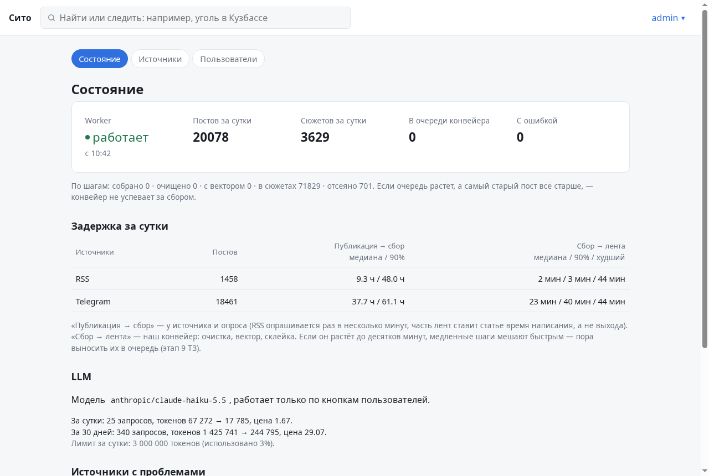
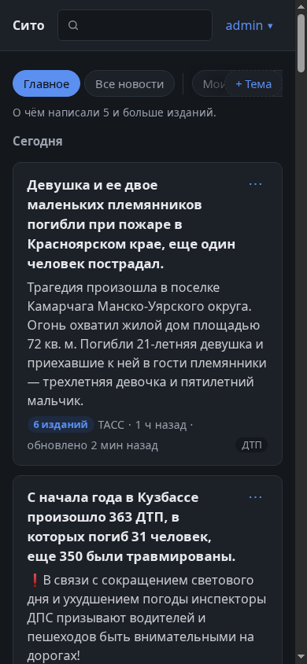
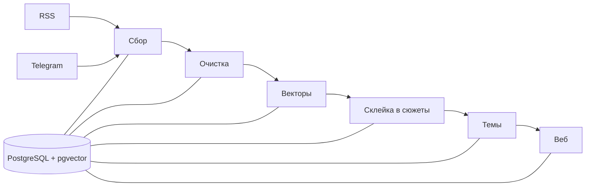

# Сито

Новостной агрегатор, который ставится на свой сервер. Читает RSS-ленты и Telegram-каналы, находит одну и ту же
новость у разных изданий и показывает её одной карточкой: сколько изданий написали, кто был первым, как менялись
подробности. Сверху — фильтр по своим темам, чтобы из тысяч постов в день видеть только нужное.




## Почему сделал

Слежу за новостями своего региона и угольной отрасли. Это два десятка Telegram-каналов и сайтов, где одну и ту же
новость пересказывают по десять раз, а действительно важное теряется среди перепостов. Готовые агрегаторы узкие
каналы не читают, а системы мониторинга СМИ сделаны для компаний и стоят соответственно. Захотелось ленту, где
дубли схлопнуты, а темы задаются обычными словами.

## Что умеет

- **Склеивает дубли.** Пост ТАСС и пятнадцать его пересказов в каналах — одна карточка («сюжет») с хронологией.
  Вкладка «Главное» — сюжеты, о которых написали пять и больше изданий.
- **Темы.** Пишешь «уголь Кузбасс» — получаешь отдельную ленту. Перед созданием видно, что в неё попадёт и сколько
  сюжетов в день ждать. Лишнее убирается кнопкой «Не по теме», и тема начинает отсеивать похожее; спорные сюжеты
  она сама спрашивает «Подходит?».
- **Поиск** по словам в любой форме («угля» найдёт «уголь») и по смыслу.
- **LLM по кнопке** (необязательно): пересказ сюжета, сводка по теме за неделю, ответ на вопрос со ссылками на
  сюжеты, дайджест по расписанию. Без ключа всё остальное работает.
- **Telegram** через служебный аккаунт: вход по QR-коду, каналы добавляются ссылкой, папкой или поиском.
- **Админка**: жив ли фоновый процесс, успевает ли обработка, какие источники сломались или замолчали, сколько
  потрачено на LLM.

| Сюжет: 17 изданий в одной карточке | Поиск: что попадёт в тему, а что нет |
|---|---|
|  |  |
| **Мои темы** | **Настройки темы** |
|  |  |
| **Админка** | **С телефона, тёмная тема** |
|  |  |

Сейчас у меня в работе 444 источника (17 RSS и 427 каналов), это около 20 тысяч постов в сутки, из которых
получается примерно 3,6 тысячи сюжетов. LLM обходится в 8–10 рублей в день.

## Как устроено

Два процесса над одной базой PostgreSQL:

- **worker** собирает посты и проводит каждый через цепочку шагов: очистка HTML и мусора → вектор текста
  (локальная модель `multilingual-e5-base`) → поиск сюжета, к которому пост относится → проверка, в какие темы
  пользователей попадает сюжет;
- **web** — FastAPI с шаблонами Jinja2 и HTMX, без отдельного фронтенда.



Несколько решений, о которых интересно поговорить:

**Очередь без брокера.** У поста есть статус (`new → cleaned → embedded → clustered`), и каждый шаг забирает
пачку постов через `SELECT … FOR UPDATE SKIP LOCKED`, обрабатывает и меняет статус в той же транзакции. Если процесс
упал, транзакция откатится и пачку возьмут заново. При моём объёме Redis или RabbitMQ были бы лишней деталью;
в [docs/САМОПРОВЕРКА.md](docs/САМОПРОВЕРКА.md) описано, по какому замеру станет понятно, что очередь всё-таки нужна.

**Как решается, что два поста — одна новость.** Сначала по ссылкам: если пост ссылается на статью, которая уже
есть в сюжете, он идёт туда. Если ссылок нет — по похожести векторов среди сюжетов за ±6 часов. Пороги похожести
я не придумывал, а подобрал по 160 вручную размеченным парам постов (лежат в [eval/](eval/)): для постов
одного издания порог выше, чем для разных. Ещё одна проверка нужна, чтобы большой сюжет не «расползался»: пост должен быть
похож не только на ближайший пост, но и на сюжет в целом. Код — [`services/clustering.py`](src/sito/services/clustering.py).

**Telegram без потерь.** Для каждого канала хранится номер последнего сохранённого сообщения. После перезапуска
сборщик догружает всё, что пропустил, и не сдвигает номер, пока догрузка не закончена, иначе сообщения из
промежутка терялись бы. Если соединение «зависло» и посты перестали приходить, его перезапускает отдельная
проверка. Код — [`collector/telegram.py`](src/sito/services/collector/telegram.py).

**LLM только как дополнение.** Пока модель отвечает, соединение с базой не занято; на день есть лимит в рублях,
общий и на пользователя; каждый запрос записывается с ценой. Код — [`services/llm.py`](src/sito/services/llm.py).

**Тесты на настоящей базе.** Около 330 тестов работают с PostgreSQL + pgvector, а не с моками: каждый тест
выполняется в транзакции, которая потом откатывается. Telegram, HTTP и LLM в тестах подменены, сеть не нужна.

## Что пока не так

- Темы иногда цепляют лишнее: в «ДТП» попадает происшествие, просто похожее по смыслу. Порог похожести для тем
  стоит подобрать так же, как для склейки, по размеченным данным.
- Посты из Telegram доходят до ленты с медианой около 20 минут против пары минут у RSS. Замер виден в админке,
  причину ещё не разбирал.
- Всё работает одним процессом worker'а. Для одного сервера этого хватает, но горизонтально он не масштабируется.

## Запуск

```bash
cp .env.example .env
# в .env: SITO_SECRET_KEY (python3 -c "import secrets; print(secrets.token_urlsafe(32))") и POSTGRES_PASSWORD
docker compose up -d
docker compose exec web sito user create admin --admin
docker compose exec web sito source add "ТАСС" https://tass.ru/rss/v2.xml
```

Сайт откроется на http://127.0.0.1:8000. При первом запуске скачивается модель для векторов (около 1 ГБ).
Подключение Telegram и LLM, бэкапы, настройки и выход в интернет описаны в [docs/DEPLOY.md](docs/DEPLOY.md).

Для разработки:

```bash
docker compose up -d db
uv sync && uv run alembic upgrade head
uv run pytest
uv run ruff check src tests && uv run mypy src
```

## Стек

Python 3.13, FastAPI, Jinja2, HTMX, SQLAlchemy 2 (async), PostgreSQL 16 + pgvector, Alembic, sentence-transformers,
Telethon, pymorphy3, trafilatura, Docker Compose. Инструменты: uv, ruff, mypy, pytest.

```
src/sito/
├── worker/        фоновый процесс: сбор и шаги обработки
├── web/           FastAPI, шаблоны, статика
├── services/      логика: сбор, очистка, векторы, склейка, темы, поиск, LLM
├── repositories/  запросы к базе
├── models/        таблицы SQLAlchemy
└── cli.py         консольные команды
```

## Документы

- [docs/ТЗ.md](docs/ТЗ.md) — техническое задание, с которого начинал, и этапы
- [docs/САМОПРОВЕРКА.md](docs/САМОПРОВЕРКА.md) — что будет при сбоях, сколько стоит, где узкие места
- [docs/DEPLOY.md](docs/DEPLOY.md) — развёртывание и эксплуатация
- [docs/UI.md](docs/UI.md) — правила оформления интерфейса
