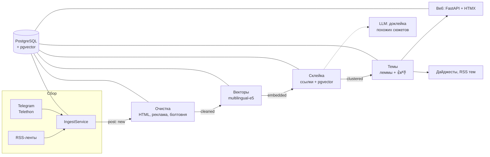

# Сито — персональный радар новостей

**Self-hosted агрегатор, который превращает поток из сотен RSS-лент и Telegram-каналов в ленту сюжетов:
одна новость из двадцати изданий — одна карточка, с хронологией и тем, кто написал первым.**


## Зачем

Кто следит за отраслью или регионом, читает 20–40 источников и упирается в три проблемы: одну новость
перепечатывают 10–15 изданий, нужное тонет в сотнях постов в день, а о важном узнаёшь через полдня.
Общие агрегаторы не читают узкие Telegram-каналы, а системы мониторинга СМИ рассчитаны на корпорации.

Сито собирает источники, **склеивает перепечатки в сюжеты** и показывает только то, что относится к **вашим темам**.
Темы задаются обычным текстом («уголь в Кузбассе») или описанием своими словами — и учатся на отметках «подходит / не подходит».

## В цифрах (живая установка)

| | |
|---|---|
| Источники | 444: 17 RSS-лент и 427 Telegram-каналов |
| Поток | ~20 000 постов в сутки → ~3 600 новых сюжетов |
| От сбора до ленты | RSS — медиана 2 минуты |
| Стоимость LLM | 8–10 ₽ в день (всё остальное работает без LLM и бесплатно) |
| Качество склейки | пороги подобраны по 160 размеченным парам постов ([eval/](eval/)) |
| Тесты | 335, на настоящем PostgreSQL + pgvector, без сети |

## Как выглядит

| Сюжет: хронология из 17 изданий | Поиск показывает, что попадёт в тему |
|---|---|
|  |  |
| **Мои темы** | **Настройки темы** |
|  |  |
| **Администрирование: состояние конвейера** | **Телефон, тёмная тема** |
|  |  |

## Возможности

- **Лента сюжетов** без копий: сколько изданий подхватили, кто был первым, как развивалось событие; «Главное» —
  о чём написали 5+ изданий; отметки прочитанного и «вы были здесь».
- **Темы**: по словам (в любой форме — леммы) или по описанию через LLM; учатся на 👍/👎 и сами подстраивают строгость;
  можно ограничить источниками; RSS-лента темы по секретному адресу.
- **Поиск** по словам и по смыслу; перед «Следить» видно, сколько сюжетов в день будет в теме.
- **LLM по кнопке**: пересказ сюжета, сводка темы за период, ответ на вопрос по теме со ссылками на сюжеты,
  дайджест по расписанию, проверка спорных сюжетов по описанию темы. В фоне — только доклейка недосклеенного.
- **Источники**: RSS/Atom и Telegram (служебный аккаунт, вход по QR или коду; добавление по ссылке, папке,
  поиску, «похожим каналам»); полный текст статей для коротких постов.
- **Администрирование**: жив ли worker, успевает ли конвейер, задержки, сломавшиеся и замолчавшие источники,
  расход LLM, пользователи. Уведомления о поломках — в Telegram.

## Как устроено



Два процесса: **worker** (один asyncio-процесс с независимыми циклами: опрос лент, слушатели Telegram, шаги
конвейера, полные тексты, дайджесты, хранение 90 дней) и **web** (FastAPI, Jinja2, HTMX — без SPA и сборки фронтенда).
Слои: `models → repositories (SQL) → services (логика) → web/routes, worker`.

## Инженерные решения, которые стоит посмотреть

- **Конвейер на статусе поста, без брокера сообщений.** Каждый шаг берёт пачку `FOR UPDATE SKIP LOCKED` и меняет
  статус в той же транзакции: падение откатывает пачку целиком, ничего не теряется и не обрабатывается дважды;
  ошибки поста считаются, после трёх — `failed` с кнопкой «Повторить». Когда понадобится очередь и какой замер это
  покажет — [САМОПРОВЕРКА §10](docs/САМОПРОВЕРКА.md). → [`services/pipeline.py`](src/sito/services/pipeline.py),
  [`worker/__main__.py`](src/sito/worker/__main__.py)
- **Склейка: сначала факты, потом похожесть.** Пост со ссылкой на статью другого издания приклеивается к её сюжету;
  иначе — ближайший сюжет по вектору в окне ±6 ч, с отдельными порогами для одного и разных изданий и проверкой
  похожести на центр сюжета (иначе крупный сюжет «расползается» цепочкой). Пороги — по размеченным парам, а не
  на глаз; склейка под advisory-блокировкой. → [`services/clustering.py`](src/sito/services/clustering.py)
- **LLM как дополнение, а не основа.** Без ключа работает всё, кроме кнопок LLM. Во время запроса к модели
  соединение с базой отпущено; лимиты в токенах и рублях (общий и на пользователя); двойной клик не платит дважды;
  каждый вызов записан с ценой. → [`services/llm.py`](src/sito/services/llm.py)
- **Telegram без потерь.** Слушатель держит курсор по каждому каналу; после простоя догружает пропущенное, и
  курсор в базе не двигается, пока канал не догружен; сторож перезапускает «зависшее» соединение по тишине в базе.
  → [`collector/telegram.py`](src/sito/services/collector/telegram.py)
- **Чистка данных по статистике.** Агрегаторы ставят имя канала-первоисточника первой строкой каждого репоста —
  очистка узнаёт такие подписи по повторам и не делает их заголовками; короткая болтовня («Доброе утро)»)
  отсеивается. → [`services/cleaning.py`](src/sito/services/cleaning.py)
- **Темы и поиск.** Слова — леммы pymorphy3 и полнотекстовый индекс Postgres; ранжирование поиска — idf по леммам
  с весом заголовка и свежестью; по смыслу — pgvector. Тема — слова плюс похожесть на 👍-примеры минус похожесть на 👎.
  → [`services/topics.py`](src/sito/services/topics.py), [`services/search.py`](src/sito/services/search.py)
- **Безопасность.** Пароли argon2, CSRF на всех изменяющих запросах, ограничение попыток входа, секреты подключений
  зашифрованы (Fernet), полный текст статей скачивается только с публичных адресов (защита от SSRF).
- **Тесты на настоящей базе.** PostgreSQL + pgvector, каждый тест в откатываемой транзакции на одном соединении;
  Telegram, HTTP и LLM подменены; отдельный тест сверяет модели с миграциями.

Почему так, а не иначе, и что будет при сбоях — ответы в [docs/САМОПРОВЕРКА.md](docs/САМОПРОВЕРКА.md).

## Стек

Python 3.13 · FastAPI · Jinja2 + HTMX · SQLAlchemy 2 (async) · PostgreSQL 16 + pgvector · Alembic ·
sentence-transformers (`intfloat/multilingual-e5-base`) · Telethon · pymorphy3 · trafilatura · httpx ·
uv · ruff · mypy · pytest · Docker Compose

## Быстрый старт

```bash
cp .env.example .env
python3 -c "import secrets; print(secrets.token_urlsafe(32))"   # → SITO_SECRET_KEY в .env, там же POSTGRES_PASSWORD
docker compose up -d
docker compose exec web sito user create admin --admin
docker compose exec web sito source add "ТАСС" https://tass.ru/rss/v2.xml
```

Откройте http://127.0.0.1:8000. Команды, резервные копии, подключение Telegram и LLM, настройки, выход в
интернет — в [docs/DEPLOY.md](docs/DEPLOY.md).

## Разработка

```bash
docker compose up -d db && uv sync && uv run alembic upgrade head
uv run pytest && uv run ruff check src tests && uv run mypy src
```

```
src/sito/
├── worker/        независимые циклы: сбор, шаги конвейера, дайджесты, хранение
├── web/           FastAPI, шаблоны Jinja2, HTMX, статика
├── services/      логика: сбор, очистка, векторы, склейка, темы, поиск, LLM
├── repositories/  запросы к базе (часто сырой SQL)
├── models/        таблицы SQLAlchemy
└── cli.py         команды sito …
migrations/        Alembic
eval/              размеченные пары постов для подбора порогов склейки
```

## Документы

- [docs/ТЗ.md](docs/ТЗ.md) — техническое задание: назначение, сценарии, этапы
- [docs/САМОПРОВЕРКА.md](docs/САМОПРОВЕРКА.md) — поведение при сбоях, стоимость, узкие места
- [docs/DEPLOY.md](docs/DEPLOY.md) — развёртывание и эксплуатация
- [docs/UI.md](docs/UI.md) — правила оформления интерфейса
